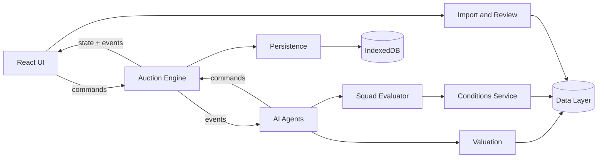
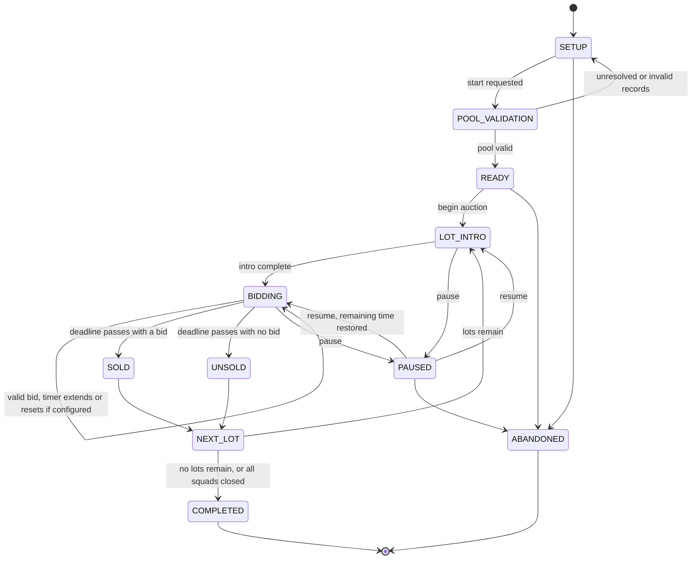
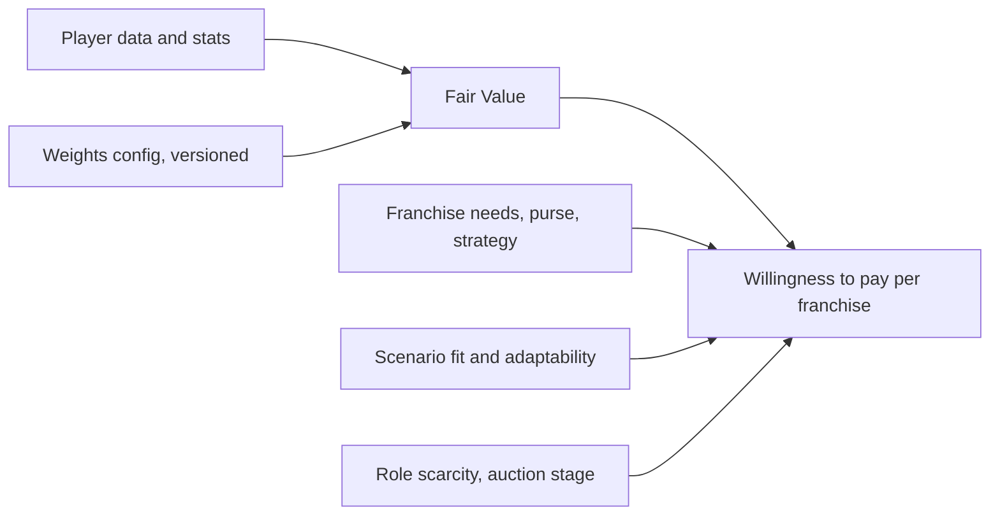
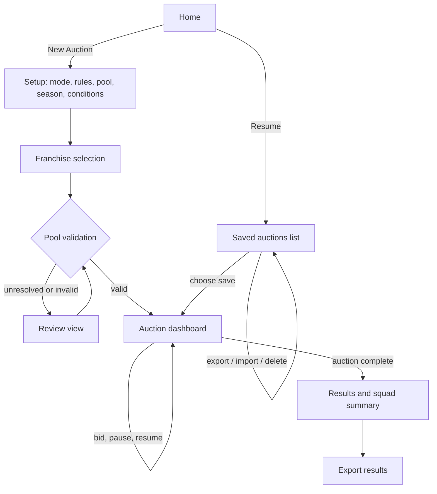

# Design Document

## Overview

The IPL AI Auction Game is a static, browser-only single-page application. One human controls one franchise and bids against nine AI agents. A single UI-independent rules engine owns all auction state. Everything runs in the browser and is hosted on GitHub Pages.

Design principles:
- Core logic lives in plain TypeScript packages with no React or DOM imports, so it can be tested alone and moved to a server later if needed.
- The Auction_Engine is the single source of truth. The UI and AI agents send commands to it and read state from it.
- Data files are versioned and validated. Every value carries provenance, and unknown stays unknown.
- Proposed stack (confirmed in Stage 2 approval): Vite, React, TypeScript, Tailwind, Zod for schemas, Vitest, Playwright, GitHub Actions. Nothing is installed yet.

## Auction Modes

| Mode | Opening state | Pool | Rules |
|---|---|---|---|
| IPL 2027 Mini Auction | Each franchise starts with its own retained squad and remaining purse (Requirement 22) | The published Final_Auction_List and player sets. The 1,220-name Auction_Register is a registration list only | Season rules file with source and verification status per value |
| Mega Auction (configurable) | Empty squads and one configured purse, unless the configuration supplies opening states | Configurable pool | Template rules file for future seasons and custom simulations |

Both modes use the same engine. Nothing mode-specific is coded in the engine: purse, squad limits, overseas limits, slot counts, increments, payment caps, Right to Match, Impact Player and set order are read from the rules file. The 2026 Mock Auction mode in the playbook is replaced by the IPL 2027 Mini Auction.

## Architecture



### Repository layout (proposed)

```
/src
  /core            no React or DOM imports
    /money         integer-rupee helpers and formatting
    /engine        auction state machine, commands, events, clock
    /rules         rules configuration schemas and presets
    /pool          registration, eligibility, classification, set building
    /valuation     fair value and willingness to pay
    /squad         squad evaluation and adaptability
    /conditions    venues, pitches, scenarios
    /agents        AI agents, profiles, decision log
    /persistence   save schema, migrations, export/import, tab lock
    /simulation    simulation harness
  /ui              React components, screens, hooks
  /data            versioned JSON/CSV and schemas
/tests             unit, integration, simulation, e2e
/.github/workflows CI and Pages deploy
```

### Module boundaries

| Module | Owns | Must not |
|---|---|---|
| engine | Auction state, bids, purses, timers, lot status, squad ownership | Import UI or agent code |
| agents | Decisions, per-franchise state, reasons | Change engine state except through commands |
| valuation | Fair value, WTP, breakdowns | Read or change engine state |
| squad | Squad reports, marginal value | Place bids |
| conditions | Venue, pitch, scenario profiles | Fetch data at runtime without validation |
| persistence | Saves, migrations, export/import, tab lock | Contain rules |
| ui | Rendering, input, layout | Contain auction rules |

## Components and Interfaces

### Auction engine API

```ts
type Money = number; // integer rupees, validated as safe integer >= 0

interface BidCommand {
  requestId: string;        // idempotency key
  franchiseId: string;
  lotId: string;
  amount: Money;
  expectedBidVersion: number; // stale-client protection
}

interface EngineResult<T> { ok: boolean; reason?: RejectReason; value?: T; stateVersion: number }

interface AuctionEngine {
  getState(): AuctionState;                       // immutable snapshot
  subscribe(fn: (e: AuctionEvent) => void): () => void;
  startAuction(): EngineResult<void>;
  submitBid(cmd: BidCommand): EngineResult<BidAccepted>;
  declinePlayer(franchiseId: string, lotId: string, requestId: string): EngineResult<void>;
  pause(): EngineResult<void>;
  resume(): EngineResult<void>;
  tick(): void;                                   // evaluates deadlines using the Clock
  getNextValidBid(franchiseId: string): Money | null;
  canBid(franchiseId: string): { allowed: boolean; reason?: RejectReason };
  serialize(): SerializedAuction;
  static restore(s: SerializedAuction, clock: Clock): AuctionEngine;
}

interface Clock { now(): number }                 // monotonic milliseconds: performance.now() in the app, fake clock in tests
```

Rules for the engine:
- Commands are processed one at a time in a single synchronous queue, which prevents two winning bids on one lot.
- A processed `requestId` returns its stored result.
- A bid with an old `expectedBidVersion` is rejected as stale.
- State is replaced, never mutated in place, and `stateVersion` increases on every change.
- Money arithmetic uses integers only. Every transition asserts that purses plus spend equal the starting total.

### Rejection reasons

`AUCTION_NOT_ACTIVE`, `PAUSED`, `LOT_NOT_BIDDABLE`, `STALE_BID_VERSION`, `DUPLICATE_REQUEST` (returns original result), `BELOW_MINIMUM_BID`, `INVALID_INCREMENT`, `INSUFFICIENT_PURSE`, `PURSE_RESERVE_VIOLATION`, `SQUAD_FULL`, `OVERSEAS_LIMIT`, `ROLE_CONSTRAINT`, `ALREADY_HIGHEST_BIDDER`, `FRANCHISE_WITHDRAWN`, `PLAYER_NOT_IN_POOL`.

### Auction state machine



A reloaded auction always restores into PAUSED with `remainingMs` stored, and resumes on user action.

Timer model: `deadlineAt` (monotonic ms) is stored while running and `remainingMs` while paused. `tick()` compares `clock.now()` with `deadlineAt`. When the page becomes hidden (tab switch, screen lock), the app pauses the auction and stores `remainingMs`, because browsers throttle timers in background tabs and the user would otherwise lose lots while away. On return the auction stays paused until the user resumes.

### Background throttling, screen lock and device changes

Browsers throttle or suspend timers in background tabs, and iOS may suspend a page without warning. The design avoids depending on timers firing on time:

- Running time uses a monotonic clock (`performance.now()`), not `Date.now()`, so system clock or time zone changes cannot move a deadline. Wall-clock time is stored only as a label.
- The timer loop records the time of each evaluation. If the gap since the last evaluation exceeds a threshold (for example a few seconds), the page was suspended or throttled. The engine then pauses and restores `remainingMs` from the last evaluation before the gap. It does not sell, pass or accept bids for the missed interval.
- On `visibilitychange` to hidden, and on `pagehide` and `freeze`, the app pauses and saves immediately. On iOS, where these events may not arrive before suspension, the save made at the last accepted command and the last periodic save act as the fallback, and a reload always restores as paused.
- AI actions are scheduled on the engine clock and are cancelled on pause, so no AI bid is submitted for a paused or missed interval. When the auction resumes, agents re-evaluate against the current state.
- Where the browser supports a screen wake lock, the app requests one during live bidding to avoid screen-lock suspension. Behaviour is correct without it.
- Changing devices: Export pauses the session and writes the paused state, an export identifier and a lineage identifier. Importing creates a new save on the other device in the paused state. If the file shares a lineage with an existing save, the user chooses between a new copy and replacing it. The two copies diverge as soon as either is played, and the dialog says so.

### Sets and lots

`pool` builds Auction_Sets from verified Classification and the configured set order. The engine receives an ordered lot list. When Classification changes before the auction, `pool` rebuilds and re-sorts the sets, and the new list becomes the auction's snapshot. Once an auction has started, its set list and data snapshot are fixed.

## Data Models

All entities carry `id`, and data files carry `schemaVersion` and `dataVersion`.

### Provenance (embedded in data records)

```ts
interface Provenance {
  source: string;            // name of the source
  sourceRef?: string;        // URL or document reference
  retrievedAt?: string;      // ISO timestamp
  updatedAt?: string;
  verifiedAt?: string;
  confidence: 'high' | 'medium' | 'low' | 'unknown';
  freshness?: 'fresh' | 'stale' | 'unknown';
  isSample?: boolean;        // true for development data, shown in UI as sample
}
```

### Core entities

| Entity | Key fields |
|---|---|
| Franchise | id, code, name, colours, defaultStrategyId |
| PlayerMaster | id, displayName, nationality, dateOfBirth?, primaryRole, battingHand?, bowlingStyle?, tags[], provenance |
| SeasonRegistration | id, playerId, season, status (registered, not_registered, withdrawn, unresolved), registrationDate?, eligibility (eligible, ineligible, unresolved), basePrice?, categoryHint?, provenance, reviewNote? |
| Classification | id, playerId, season, status (capped, uncapped, unresolved), ruleVersion, effectiveDate, explanation, provenance, supersedes? |
| ClassificationReview | id, classificationId, changedBy, changedAt, previousValue, newValue, reason |
| PlayerStats | id, playerId, season?, scope (career, recent, split), split? (vs pace, vs spin, venue type, powerplay, middle, death, day, night), metrics (values or null), sampleSize, provenance |
| Venue | id, name, city, dimensions?, boundaryNotes?, surface?, provenance |
| PitchProfile | id, venueId, pace?, bounce?, grip?, turn?, spinAssist?, paceAssist?, avgFirstInningsScore?, chasingTendency?, dewImpact?, dayNightNotes?, provenance, dateRange |
| ConditionsRecord | id, venueId, kind (historical_climate, forecast, observed), temperature?, humidity?, rainProbability?, rainAmount?, wind?, cloudCover?, dewLikelihood?, dewIntensity?, issuedAt? (forecast), validAt?, provenance |
| Scenario | id, name, description, requiredDataFields[], weights |
| TournamentConfig | id, season, venues[] with weights, scenarios[] with weights, dominanceLimit |
| AuctionRules | id, mode, defaultStartingPurse (used only when no opening state is supplied), purseReserveRule?, increments (price bands), squadMin, squadMax, overseasMax, roleConstraints, retentionRules, rtmEnabled, overseasPaymentCap (limits the recorded player payment, purse is still deducted in full), impactPlayerEnabled, acceleratedRounds?, setOrder, timer (duration, extension, reset), restrictions |
| FranchiseOpeningState | id, season, franchiseId, purse (rupees), squad[] (playerId, acquisitionPrice?, isOverseas), overseasCount, availableSlots, provenance, verifiedAt |
| AuctionPool | id, season, kind (register, provisional, final, sample), publishedAt?, source, playerIds[], sets[] (setId, name, order, playerIds[]), diffFromRegister? |
| RuleValueStatus | ruleKey, value, status (verified, unverified), source, verifiedAt? |
| AuctionSession | id, createdAt, updatedAt, status, mode, season, humanFranchiseId, rules (snapshot), dataVersions, seed, engineState, aiProfiles, decisionLog, conditionsProfile, tournamentConfig |
| Bid | id, lotId, franchiseId, amount, at, requestId, accepted, rejectReason? |
| SquadEntry | franchiseId, playerId, price, acquiredAt, lotId |
| AIDecision | id, franchiseId, lotId, at, kind (BID, PASS, WITHDRAW, WAIT), amount?, reason, inputsSummary, valuationVersion |

Notes:
- Unknown is stored as `null` or absent, never as zero.
- Money fields use integer rupees.
- `Classification` is separate from `SeasonRegistration`. Changing one does not change the other.
- New `Classification` records supersede older ones; older ones are kept as history.
- Venue, pitch and conditions records are read-only inputs during an auction.

### Data files

```
/data/<dataVersion>/
  franchises.json
  players.master.json
  registrations.<season>.json
  classifications.<season>.json
  stats.<season>.json
  venues.json  pitches.json  conditions.<kind>.json
  tournament.<season>.json
  rules.<mode>.<season>.json
  sample/mock-auction-list.csv   owner-supplied sample pool: set_name, set_order, set_printed_count,
                                 player, role, overseas, base_price_label, base_price_rupees, isSample
  manifest.json   file list, hashes, schemaVersion, dataVersion
```

Imports validate each file with its schema, report errors by file and field, deduplicate by stable IDs and are repeatable. Development data goes in a clearly marked sample set with `isSample: true`.

## Sample Pool

The owner's mock list is imported as an `AuctionPool` of kind `sample`. Its 47 sets keep their supplied labels and order (`set_order`), and the engine reads the lot order from the pool, not from code. Every record carries `isSample: true`, and the UI shows "SAMPLE DATA, not official" throughout. The conversion script `tools/format-mock-list.ps1` regenerates the CSV from `Mock_list.txt`, checks each set against its printed count, drops repeat players (first occurrence kept) and converts prices to whole rupees. The sample pool has no registration or classification records, so it bypasses the registration checks and is never treated as verified.

## Player Pool Pipeline

1. Load `PlayerMaster`, `SeasonRegistration`, `Classification`, `AuctionRules`, the `AuctionPool` of the right kind and the `FranchiseOpeningState` records for the selected season. For the mini-auction, the Auction_Register (kind `register`) is the registration list. The official launch requires the `final` pool, and players already in opening squads are removed from the auctionable pool.
2. Include a player only if the registration is eligible. History and reputation are not inputs.
3. Mark missing or conflicting records `unresolved` and list them for review.
4. Block launch if any record is unresolved, unless it was resolved by review or excluded by the user.
5. Build sets from classification and `setOrder`. Re-run whenever Classification or pool changes.
6. Freeze the resulting pool into the session snapshot.

## Conditions and Scenario Model

Three record kinds are never merged:
- **historical_climate** is available at auction time and is the default input.
- **forecast** needs `issuedAt` and `validAt`. It is only used when valid for the match window and fresh. A forecast issued long before the match is treated as low confidence.
- **observed** is for matchday data and is used only if present.

Scenarios: spin-friendly, pace-friendly or bouncy, batting-friendly, slow or low, humid or dewy evening, rain-affected or shortened, and balanced or unknown. A scenario is scored only for the attributes where required data exists. Each result includes a `coverage` value so the UI and agents can tell "weak" from "unknown".

Because the app has no server, weather and forecast data enters as validated files committed to the repo (or imported by the user). Live fetching in the browser is out of scope until a provider with browser access, licensing and no private key is chosen.

## Valuation and Willingness to Pay



- `FairValue = f(performance, role, skills, age/consistency, scarcity, sample size, confidence)`, returned with a per-factor breakdown. Low confidence shrinks the estimate toward a role baseline and widens a stated range.
- `WTP(franchise, player)` starts from fair value and applies need, purse headroom (including the cost of unfilled minimum slots), scarcity, auction stage, scenario fit and strategy. It never exceeds a legal maximum bid.
- Weights live in a versioned config. Every valuation stores the inputs and the version.
- No network or LLM is used.

## AI Agents

Each agent has a profile (strategy config), live state and a decision log.

```ts
interface AgentProfile {
  franchiseId: string;
  riskTolerance: number;        // 0..1
  aggressiveness: number;       // 0..1
  valueBias: number;            // pays below/above fair value on average
  needWeight: number;
  adaptabilityWeight: number;
  scenarioPreferences: Record<ScenarioId, number>;
  reservePolicy: { minReserveFraction: number };
  patience: number;             // willingness to wait for later lots
  reactionDelayMs: [number, number]; // seeded range
}
```

Decision pipeline, run when a lot opens and after each new bid:
1. Skip if the player is not in the active pool, the agent has withdrawn or the agent cannot legally bid.
2. Compute fair value, WTP, marginal squad value and scenario fit.
3. Compare the next valid bid with WTP and with alternatives still in the pool.
4. Pick BID, PASS, WITHDRAW or WAIT, and write a reason, for example "Next bid exceeds my maximum of X; two spin options remain."
5. Schedule the action after a seeded delay. When it fires, the agent re-checks against the latest state and submits through `engine.submitBid`. A rejected bid becomes a logged PASS.

Profile values for the nine AI strategies are game personas tuned in Stage 8 and checked in Stage 9. They are not claims about the real franchises' strategies. Each agent draws randomness from its own seeded PRNG stream derived from the session seed, so results are reproducible.

## Main User Flow



### Dashboard on a phone

Fixed top area: current player, current bid and bidder, countdown. Fixed bottom bar: next-bid button, pause. Tabs for My Squad, Teams (purses and counts), AI Feed, Conditions, Queue and History. The conditions tab never pushes the bid bar off-screen. On laptops the same panels appear side by side.

## Persistence

- Store: IndexedDB database `ipl-auction` with object stores `sessions`, `sessionIndex` and `meta`. localStorage is a fallback only if IndexedDB is unavailable.
- Save timing: after every accepted command, in one IndexedDB transaction that writes the serialized session and the index entry. A failed transaction leaves the previous save intact.
- Versioning: `saveSchemaVersion` in each save. Migrations run on load. An unknown or newer version is not opened and stays exportable.
- Export and import: a single versioned JSON file, validated with Zod before it is added as a new save, never overwriting an existing one without confirmation.
- Tab lock: the Web Locks API holds a lock per session ID, with a BroadcastChannel notice as fallback. A second tab opening the same session opens read-only with a notice.
- Storage warnings: the app requests persistent storage where the browser supports it, shows when it is not granted, and prompts for export. Safari on iOS may evict site data after a period without visits; this is to be checked in Stage 12 and documented with the result.
- Reload behaviour: restore as PAUSED with `remainingMs`. Export also forces a pause first (see throttling and device changes).

## Error Handling

| Situation | Behaviour |
|---|---|
| Invalid bid | Rejected with a reason, no state change, shown to the human |
| Duplicate request | Returns the stored result |
| Stale bid version | Rejected as stale, UI refreshes |
| Schema or data validation failure | Auction does not start, errors listed by file and field |
| Save write failure | Previous save kept, user warned, retry offered |
| Corrupted or unsupported save | Not opened, kept for export, clear message |
| Unexpected exception | Error boundary shows a recovery screen, last good save kept, diagnostics log available |
| Tab hidden, screen lock | Auction pauses automatically and stays paused on return. There is no server connection, so network drops do not affect play |

## Security and Privacy

- No secrets in the repo or bundle. Everything shipped is public.
- Imported files are untrusted input: size limits, schema validation, no `eval`, no HTML injection (all text is rendered as text).
- The engine rejects invalid commands even though the only client is the app itself, so rule code is the same one that tests exercise.
- No tracking and no external telemetry. Dependencies are audited in CI where tooling allows.
- Limitation, stated in the UI and README: a player can edit local data or code. There is no tamper protection, which is acceptable for single-player.

## Observability

- Structured in-memory event log (engine events, AI decisions, rejections, errors) persisted with the session.
- Diagnostics screen and downloadable log. No remote reporting.

## Testing Strategy

| Layer | Tool | Covers |
|---|---|---|
| Unit | Vitest | Money, rules, increments, squad limits, pool pipeline, classification, valuation, scenario scoring, agents |
| Property tests | Vitest with a property library (proposed, to be confirmed) | Purse conservation, one winner per lot, idempotent requests |
| Integration | Vitest | Engine plus agents, persistence round trip, import/export |
| Simulation | Node script | 100+ seeded auctions with a report |
| Browser | Playwright on Chromium, Firefox and WebKit with phone, tablet and laptop viewports | Responsive layouts, keyboard flow, pause/resume, hidden-tab and long-gap simulation, reload, two-tab lock. This is emulation, not physical-device testing |
| Real devices | Manual checklist run on the physical devices whose models the user supplies, including Android and iOS Safari | Critical flows from Requirement 14. Results are recorded only for devices actually tested |
| Accessibility | Playwright with an accessibility checker plus manual keyboard and screen-reader checks | Requirement 15 |

## Deployment

- GitHub Actions: install, lint, type-check, unit and integration tests, build with the Pages base path, publish to Pages.
- Hosting is free and static. The repository is https://github.com/ShReShT-72/untitled. It exists and is private. GitHub documents Pages for public repositories on the Free plan and for private repositories only on paid plans, so publishing needs the repository made public or a paid plan. The Pages URL would be https://shresht-72.github.io/untitled/ with the build base path set to `/untitled/`. Check current GitHub Pages terms for the repository visibility before relying on Pages. No repository is created or changed without user approval.
- Release is verified in a real browser against the live URL before a URL is reported.

## Correctness Properties

These properties are tested directly, with property-based tests where practical.

### Property 1: Purse conservation

For every franchise and every state transition, remaining purse plus total spend equals the starting purse, and no purse is negative.

**Validates: Requirements 7.3**

### Property 2: One winner per lot

For any sequence of bid commands on a lot, at most one bid is accepted as the winning bid, and a sold lot has exactly one owner.

**Validates: Requirements 6.6**

### Property 3: Idempotent commands

Submitting the same `requestId` twice leaves the state the same as submitting it once and returns the same result.

**Validates: Requirements 6.4**

### Property 4: Stale rejection

A bid carrying an outdated `expectedBidVersion` never changes state.

**Validates: Requirements 6.5**

### Property 5: Monotonic bids

Each accepted bid on a lot is higher than the previous accepted bid by at least the configured increment.

**Validates: Requirements 6.2**

### Property 6: Squad legality

No accepted sale leaves a squad above the maximum size or the overseas limit, and no purchase leaves too little purse to fill the minimum squad where the rules require it.

**Validates: Requirements 6.2**

### Property 7: Eligibility

No player outside the validated pool is ever offered, bid on or sold.

**Validates: Requirements 5.1, 12.5**

### Property 8: Classification independence

Changing a player's Classification never changes their registration or eligibility, and earlier seasons' Classification records are unchanged.

**Validates: Requirements 4.5**

### Property 9: Pause safety

While paused, no bid is accepted and the remaining time does not change. Resuming restores exactly the stored remaining time.

**Validates: Requirements 8.2, 8.3**

### Property 10: Determinism

The same seed, configuration and data versions produce the same sequence of events and decisions.

**Validates: Requirements 12.7**

### Property 11: Save round trip

Serializing and restoring an auction yields an equal state and the same next valid bid.

**Validates: Requirements 16.5**

### Property 12: Unknown is not zero

A missing statistic never contributes a numeric value to a valuation or squad score, and reduces confidence instead.

**Validates: Requirements 9.4, 17.4**

### Property 13: Agent isolation

Agents change nothing except through engine commands, and no agent acts for the human franchise.

**Validates: Requirements 12.4**

### Property 14: Throttle safety

An evaluation gap above the threshold never causes a lot to be sold or passed and never accepts a bid for the missed interval. The auction is paused with the remaining time from before the gap.

**Validates: Requirements 8.8, 8.9, 8.12**

### Property 15: Opening state integrity

Each franchise starts from its own opening purse and squad, players in opening squads never appear as lots, and for every franchise the squad size plus available slots equals the maximum squad size.

**Validates: Requirements 22.2, 22.4, 22.6**

### Property 16: Payment cap does not change the purse

When an overseas payment cap applies, the franchise purse is reduced by the full winning bid and only the recorded player payment is capped.

**Validates: Requirements 23.5**

## Requirement Traceability (summary)

| Area | Requirements |
|---|---|
| Setup, modes, franchises | 1, 2 |
| Player pool, registration, classification | 3, 4, 5, 17 |
| Engine, money, timers | 6, 7, 8 |
| Valuation, conditions, squads | 9, 10, 11 |
| AI and simulation | 12, 13 |
| UI, accessibility | 14, 15, 18 |
| Persistence | 16 |
| Delivery and quality | 19, 20 |
| IPL 2027 baseline, opening state, rule configuration | 22, 23 |
| Bonus simulator | 21 |


